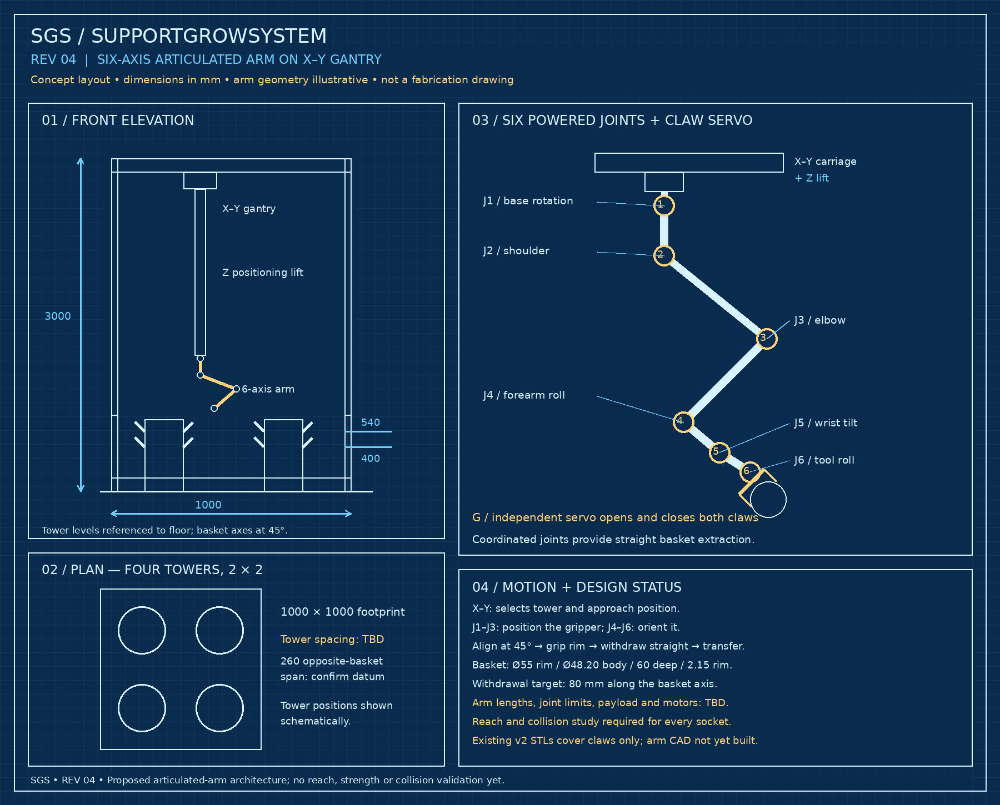

# SGS — SupportGrowSystem

An open-source, open-hardware hydroponic strawberry-growing system with a proposed 3D-printed articulated robotic arm for basket handling and fruit harvesting.

**Status: early design and untested mechanical prototypes.** This is not a working, validated machine. The repository contains printable basket-claw prototypes and design concepts. Six-axis arm CAD, electronics, firmware, machine vision, strawberry harvesting tool and integrated motion control are not implemented yet.

## Proposed architecture

- Four hydroponic towers in a 2 × 2 arrangement, within a nominal 1000 × 1000 × 3000 mm frame.
- X–Y gantry and proposed Z positioning lift carrying a compact six-axis articulated arm.
- Separate claw servo and interchangeable basket-handling / fruit-harvesting tools.
- Strawberry picker concept: soft cradle and stem cutter; not designed or validated yet.

*AI-generated architectural illustration. Shows legacy tomato plants; the current crop is strawberries. Joint geometry, tower details and dimensions in generated images are illustrative and may differ from the requirements.*

*Concept blueprint only; not a fabrication drawing or proof of reach.*

## Start here

- [Confirmed measurements and open questions](docs/requirements.md)
- [Design status and next tasks](docs/roadmap.md)
- [Two-claw prototype instructions](mechanical/grippers/two-claw-v2/README.txt)
- [Concept image gallery](docs/concepts.md)
- [Contributing](CONTRIBUTING.md)
- [Licensing](LICENSE.md)

## Files

| Folder | Contents |
|---|---|
| mechanical/grippers/two-claw-v2 | OpenSCAD source, STL exports, manual assembly instructions |
| mechanical/archive/fit-fork-v1 | Superseded manual fit-test fork and generating script |
| mechanical/arm | Current arm design status; detailed CAD pending |
| docs | Measurements, blueprints, images and roadmap |
| electronics / firmware / software | Scope notes; implementation pending |
| bom | Preliminary parts categories; procurement list pending |

## Prototype verification

The exported gripper STL meshes were checked for closed edges at generation. No physical prints, loaded tests, extraction trials, servo compatibility checks or machine-level collision tests have been confirmed. Mesh closure does not establish printability, assembly clearance or strength. Start with manual fitting of an empty basket.

## Licenses

Hardware: CERN-OHL-S-2.0. Software: GPL-3.0-or-later. Documentation and project illustrations: CC-BY-SA-4.0, to the extent rights exist. See [LICENSE.md](LICENSE.md) and full texts in LICENSES/.
