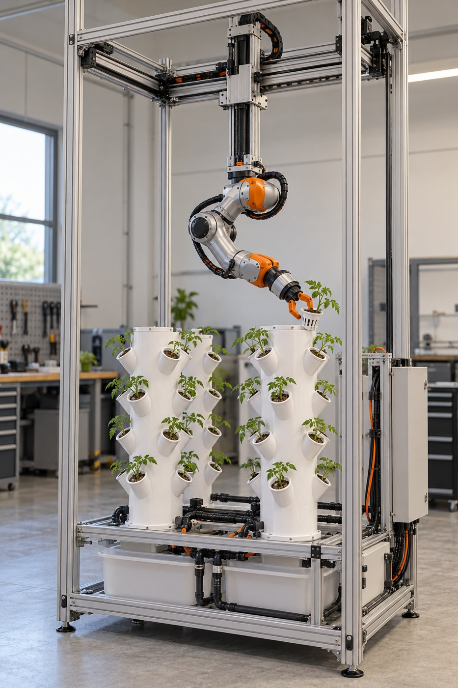
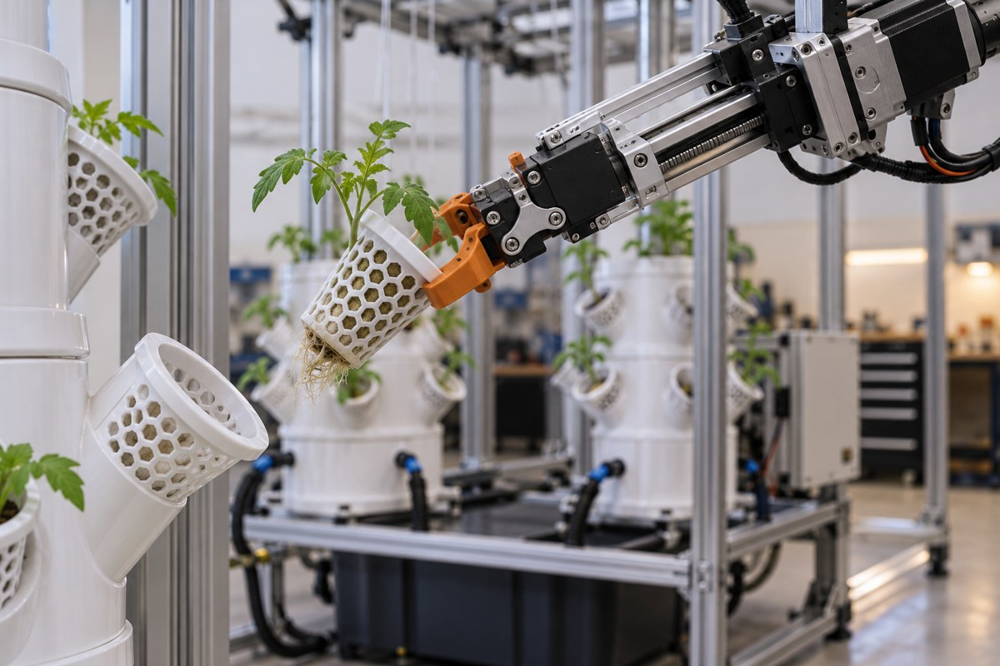
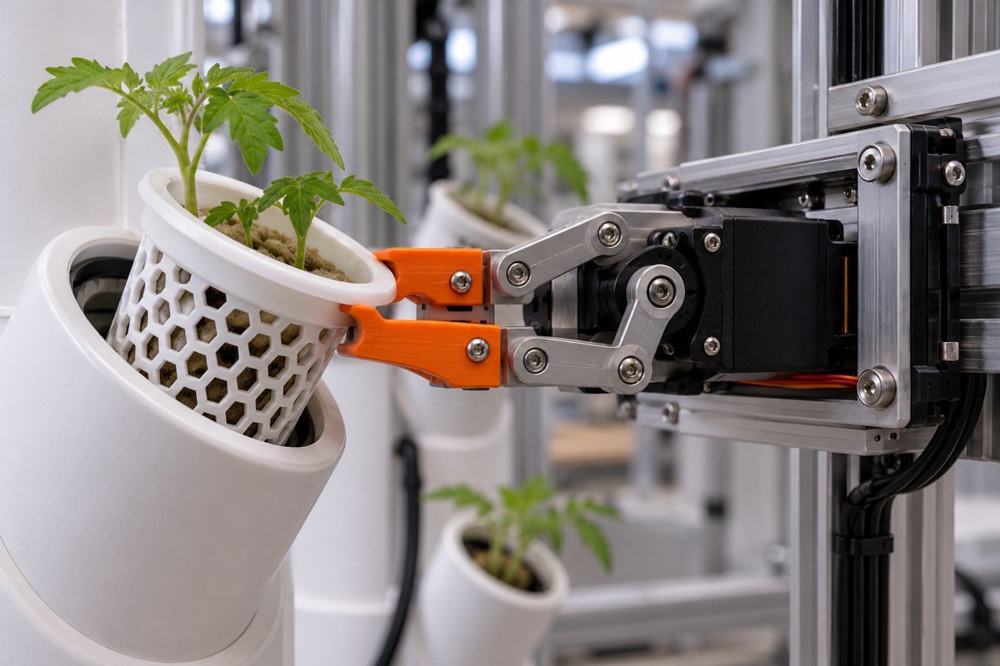
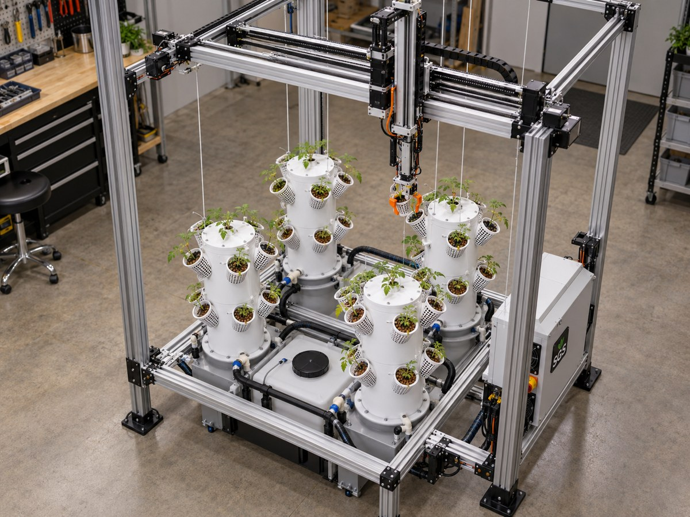
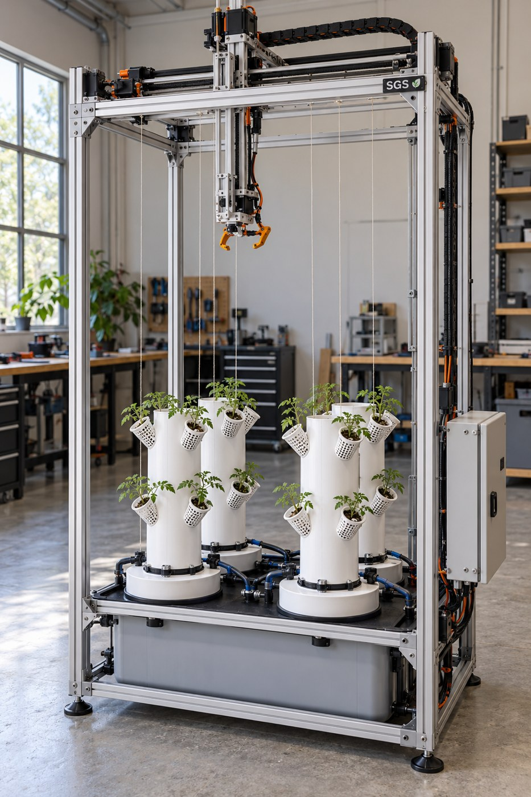
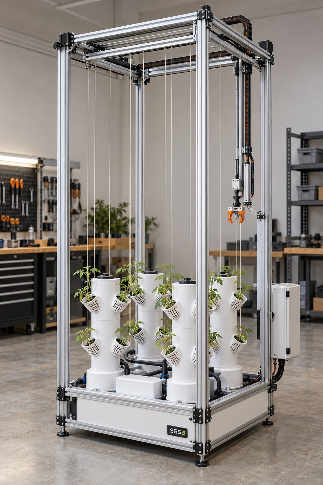
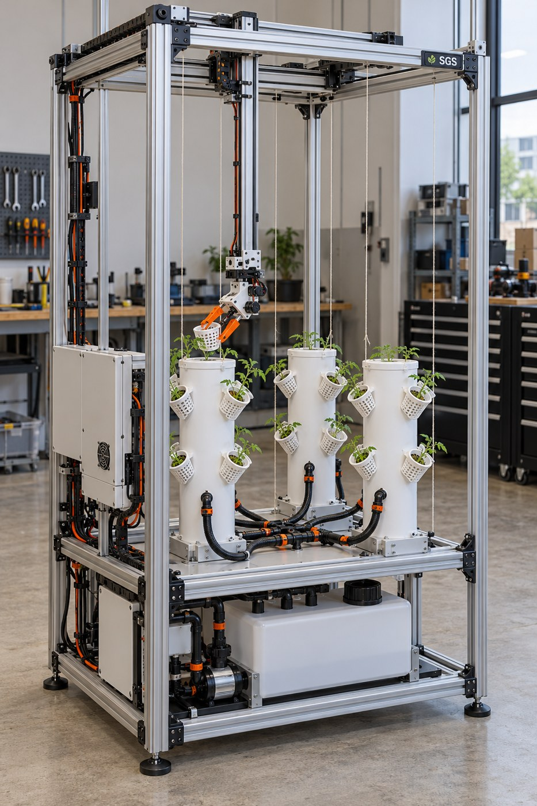

# Concept gallery

These are AI-generated design illustrations, not photographs of built hardware or exact CAD renders. Images retain legacy tomato crops and sometimes inconsistent socket counts; current SGS requirements specify strawberries.

## Articulated Arm Concept

## Legacy Extraction

## Legacy Gripper

## Legacy Overhead

## Legacy Overview 1

## Legacy Overview 2

## Legacy Service

